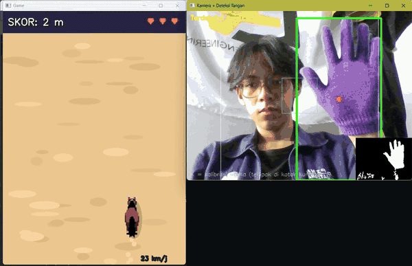
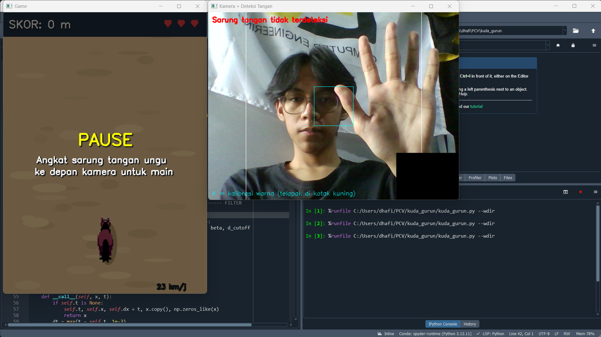

# Kuda Gurun — Game Kontrol Gerak Tangan dengan Pengolahan Citra (HSV)

Game menghindari rintangan bertema padang pasir. Pemain mengendalikan seekor kuda hanya dengan **menggerakkan sarung tangan berwarna ungu di depan kamera**. Seluruh deteksi tangan dibuat dari nol memakai teknik pengolahan citra klasik (ruang warna HSV, thresholding, operasi morfologi, analisis kontur) **tanpa MediaPipe** dan tanpa model *machine learning*.

Proyek ini dibuat untuk tugas mata kuliah **Pengolahan Citra Video**.

## Video Demo

<p align="center">
  <a href="assets/Video_Demo.mp4">
    
  </a>
</p>

## Penjelasan Game

Kamu bermain sebagai seekor **kuda yang berlari di padang pasir**. Pandangan game adalah **dari atas (top-down)**: kuda berada di bagian bawah layar dan bisa bergerak **ke kiri dan ke kanan**, sementara pasir dan **kaktus** bergulir turun dari atas.

### Cara bermain

- Pakai **sarung tangan ungu** dan angkat ke depan kamera.
- **Geser tangan ke kiri atau kanan**, dan kuda ikut bergerak ke arah yang sama.
- Hindari kaktus yang datang dari atas.
- Kalau sarung tangan tidak terdeteksi lebih dari 0,4 detik, game **berhenti otomatis (PAUSE)** dan lanjut lagi saat tangan terdeteksi.

<p align="center">
  <a href="assets/Demo_Pause.png">
    
  </a>
</p>

### Aturan permainan

| Komponen | Aturan |
|---|---|
| **Nyawa** | Pemain punya **3 nyawa**. Setiap menabrak kaktus, nyawa berkurang 1. Setelah tertabrak, kuda berkedip dan **kebal selama 1,5 detik**. Nyawa habis berarti **Game Over**. |
| **Skor** | Skor adalah **jarak yang ditempuh kuda** dalam meter (40 piksel = 1 meter). Skor tertinggi sesi ditampilkan di layar Game Over. |
| **Kecepatan** | Kuda makin kencang seiring jarak, dari 260 hingga 560 piksel/detik. |
| **Kepadatan kaktus** | **Makin jauh skornya, makin sering kaktus muncul.** Jarak antar baris kaktus mengecil dari 520 px sampai 300 px, jumlah kaktus per baris bertambah (maksimal 4), dan kaktus besar makin sering muncul. |
| **Anti menumpuk** | Kaktus dalam satu baris selalu punya jarak kosong minimal 26 px, jadi tidak ada sprite yang bertumpukan. |
| **Adil** | Setiap baris selalu menyisakan celah yang cukup lebar untuk kuda, dan celah itu bisa dijangkau dari celah baris sebelumnya dengan kecepatan gerak tangan yang wajar. |

---

## ✅ Pemenuhan Ketentuan Tugas

| Ketentuan | Implementasi |
|---|---|
| Tidak boleh memakai MediaPipe | Hanya memakai **OpenCV** dan **NumPy**. |
| Wajib menggunakan HSV | Deteksi tangan dilakukan di ruang warna **HSV** dengan `cv2.cvtColor` dan `cv2.inRange`. |
| Fokus pada pengolahan warna tangan sebagai input game | Posisi horizontal sarung tangan ungu menjadi input yang menggerakkan kuda. |
| Ada skor | Skor = jarak tempuh (meter). |
| Ada nyawa | 3 nyawa, berkurang saat menabrak kaktus. |

---

## Alur Pengolahan Citra

```
Frame kamera (BGR)
      │
      ▼
 Flip horizontal (efek cermin)
      │
      ▼
 Gaussian Blur 7×7  ──────────►  mengurangi noise
      │
      ▼
 Konversi BGR → HSV
      │
      ▼
 Thresholding HSV (cv2.inRange)  ─►  mask biner warna ungu
      │
      ▼
 Morfologi: Opening → Closing  ───►  buang bintik, tutup lubang kecil
      │
      ▼
 Rata-rata antar frame (temporal) ─►  mask tidak berkedip
      │
      ▼
 Isi kontur luar + buang serpihan kecil
      │
      ▼
 Closing besar 31×31  ────────────►  gabungkan potongan tangan jadi 1 blob
      │
      ▼
 Pilih blob (terdekat dari posisi sebelumnya)
      │
      ▼
 Bounding box → titik tengah (x)
      │
      ▼
 Filter One Euro (penghalus posisi)
      │
      ▼
 Pemetaan ke posisi kuda di layar game
```

---

## 🧪 Filter dan Teknik yang Digunakan

### 1. Pra-pemrosesan

| Teknik | Fungsi OpenCV | Parameter | Tujuan |
|---|---|---|---|
| **Flip horizontal** | `cv2.flip` | sumbu horizontal | Efek cermin, jadi tangan ke kanan berarti kuda ke kanan. |
| **Gaussian Blur** | `cv2.GaussianBlur` | kernel 7×7 | Menghaluskan frame dan menekan noise sebelum thresholding. |

### 2. Segmentasi warna (inti proyek)

| Teknik | Fungsi OpenCV | Parameter | Tujuan |
|---|---|---|---|
| **Konversi ruang warna BGR → HSV** | `cv2.cvtColor` | `COLOR_BGR2HSV` | Memisahkan informasi warna (Hue) dari kecerahan (Value), sehingga deteksi lebih tahan terhadap perubahan cahaya dibanding RGB. |
| **Thresholding HSV** | `cv2.inRange` | H 118–142, S 70–255, V 35–255 (default) | Menghasilkan mask biner untuk warna ungu sarung tangan. |

**Mengapa ungu?** Hue ungu (sekitar 126–129 di skala OpenCV) jarang muncul pada latar ruangan, kulit, atau pakaian umum, sehingga mask bersih dari wajah dan leher. Nilai default diukur langsung dari foto sarung tangan: Hue 126–129, Saturation sekitar 100–190, dan Value 72–233. Batas bawah Value dibuat rendah agar bagian sarung tangan yang terkena bayangan tetap terdeteksi.

### 3. Perbaikan mask

| Teknik | Fungsi OpenCV | Parameter | Tujuan |
|---|---|---|---|
| **Morphological Opening** | `cv2.morphologyEx(MORPH_OPEN)` | kernel elips 5×5, 1 iterasi | Menghapus bintik noise kecil. |
| **Morphological Closing** | `cv2.morphologyEx(MORPH_CLOSE)` | kernel elips 5×5, 2 iterasi | Menutup lubang kecil di dalam area tangan. |
| **Rata-rata temporal** | `cv2.accumulateWeighted` | α = 0,4, ambang > 110 | Merata-ratakan mask antar frame supaya tepi mask tidak berkedip. |
| **Pengisian kontur** | `cv2.findContours` + `cv2.drawContours` (isi penuh) | luas > 300 px | Mengisi semua lubang dan membuang serpihan kecil. |
| **Closing besar** | `cv2.morphologyEx(MORPH_CLOSE)` | kernel elips 31×31 | Menggabungkan potongan-potongan tangan (misalnya jari yang terpisah dari telapak) menjadi satu blob. |

### 4. Analisis objek

| Teknik | Fungsi OpenCV | Tujuan |
|---|---|---|
| **Analisis kontur** | `cv2.findContours`, `cv2.contourArea` | Mencari blob kandidat tangan (luas minimal 3000 px). |
| **Pelacakan blob terdekat** | `cv2.moments` | Setelah tangan terdeteksi, blob yang dipilih adalah yang paling dekat dengan posisi sebelumnya, sehingga objek ungu lain yang lebih besar tidak membuat posisi loncat. |
| **Bounding box** | `cv2.boundingRect` | Membungkus piksel ungu dalam satu kotak. Titik tengah kotak menjadi posisi X tangan. |

### 5. Penghalusan sinyal posisi

| Teknik | Parameter | Tujuan |
|---|---|---|
| **Filter One Euro** | `min_cutoff` = 1,0, `beta` = 0,02 | Menghaluskan posisi tangan. Sangat halus saat tangan diam (tidak bergetar) dan tetap responsif saat tangan bergerak cepat. Filter ini bekerja pada sinyal posisi, bukan pada citra. |

### 6. Pemetaan ke game

Posisi X tangan dinormalisasi dengan margin 15% di tiap sisi kamera, supaya tepi layar mudah dijangkau tanpa harus menggeser tangan sampai ujung kamera. Hasilnya dipetakan ke rentang posisi horizontal kuda.

### Kalibrasi otomatis

Tombol `K` mengambil sampel piksel dari kotak kuning di tengah kamera, menghitung **persentil ke-2 dan ke-98** dari tiap kanal H, S, dan V, lalu menambahkan margin untuk menampung bayangan dan perbedaan pencahayaan. Hasilnya langsung mengubah slider HSV.

---

## 🚀 Instalasi dan Cara Menjalankan

### Kebutuhan

- Python 3.8 atau lebih baru
- Webcam
- Sarung tangan berwarna ungu
- Library: `opencv-python` dan `numpy`

### Langkah

```bash
# 1. Pasang library
pip install opencv-python numpy

# 2. Jalankan game (dari folder yang berisi file .py dan folder assets)
python kuda_gurun.py
```

> Sesuaikan `kuda_gurun.py` dengan nama file game di repositori ini.

**Jika memakai Spyder:** di IPython Console ketik `%pip install opencv-python numpy`, restart kernel, buka file `.py`, lalu tekan **F5**.

Saat dijalankan akan muncul tiga jendela:

1. **Game**: layar permainan.
2. **Kamera + Deteksi Tangan**: tampilan kamera lengkap dengan kotak deteksi dan mask hitam-putih di pojok kanan bawah.
3. **HSV**: slider untuk mengatur rentang warna.

---

## 🎨 Kalibrasi Warna

Lakukan sekali, atau ulangi jika pencahayaan berubah.

1. Pakai sarung tangan ungu, lalu taruh telapaknya sampai menutupi **kotak kuning** di jendela kamera.
2. Klik jendela **Game**, lalu tekan **`K`** untuk auto-kalibrasi.
3. Periksa mask di pojok kanan bawah jendela kamera. Sarung tangan harus tampil sebagai bentuk putih yang utuh.
4. Kalau ada benda ungu lain yang ikut terdeteksi, persempit slider **H low** dan **H high**. Kalau mask bolong, turunkan **S low** atau **V low** sedikit.
5. Tekan **`S`** untuk menyimpan ke `hsv_config_ungu.json`. File ini dibaca otomatis pada saat game dijalankan berikutnya.

**Tips:** hadap ke sumber cahaya, pakai lengan baju yang tidak berwarna ungu, dan gunakan latar yang tidak berwarna ungu.

---

## Kontrol Keyboard

Klik jendela **Game** terlebih dahulu agar tombol terbaca.

| Tombol | Fungsi |
|---|---|
| `K` | Auto-kalibrasi warna (telapak di kotak kuning) |
| `S` | Simpan kalibrasi HSV |
| `M` | Mode mouse (uji game tanpa kamera) |
| `R` | Mulai ulang game |
| `Q` / `ESC` | Keluar |

---

## Parameter yang Bisa Diubah

Semua ada di bagian konfigurasi di awal file `.py`.

| Parameter | Fungsi |
|---|---|
| `BASE_SPEED`, `MAX_SPEED`, `ACCEL` | Kecepatan awal, kecepatan maksimum, dan laju percepatan |
| `START_ROW_GAP`, `MIN_ROW_GAP`, `ROW_DENSITY` | Jarak antar baris kaktus (kepadatan). `MIN_ROW_GAP` lebih kecil berarti game lebih sulit. |
| `HAND_SPEED` | Perkiraan kecepatan gerak tangan untuk menjamin celah kaktus bisa dijangkau |
| `CACTUS_CLEARANCE` | Jarak kosong minimal antar kaktus |
| `INVULN_TIME` | Durasi kebal setelah tertabrak |
| `START_LIVES` | Jumlah nyawa awal |
| `MARGIN` | Margin kamera saat memetakan posisi tangan ke layar |

---

## Pemecahan Masalah

| Masalah | Solusi |
|---|---|
| Kamera tidak terbuka | Tutup aplikasi lain yang memakai kamera, atau ubah `cv2.VideoCapture(0)` menjadi `1`. Di macOS, beri izin kamera untuk terminal atau Spyder. |
| Jendela tidak muncul | Pastikan terpasang `opencv-python`, bukan `opencv-python-headless`. |
| Kuda atau kaktus tampil sebagai gambar sederhana | Folder `assets` tidak ditemukan. Pastikan `assets/` berada di folder yang sama dengan file `.py`. |
| Tangan tidak terdeteksi | Ulangi kalibrasi dengan tombol `K`, tambah cahaya, atau periksa mask di jendela kamera. |
| Kuda bergetar | Turunkan `min_cutoff` pada `OneEuro()`, atau pastikan mask tangan utuh. |
| Kuda lambat mengikuti tangan | Naikkan `beta` pada `OneEuro()` (misalnya 0,05). |
| Ada benda ungu lain yang ikut terdeteksi | Persempit slider H low dan H high, atau singkirkan benda itu dari frame. |
| Tombol keyboard tidak bereaksi | Klik jendela Game dulu agar fokus berada di jendela OpenCV. |

---

## Struktur Repositori

```
.
├── game.py
├── README.md
└── assets/
    ├── Video_Demo.mp4
    ├── horse/
    │   └── north.png
    └── cactus/
        └── pixel_cactus.png
```

## 👤 Pembuat

- **Nama:** Dhafin Ardra Madany
- **NRP:** 5024241054
- **Mata Kuliah:** Pengolahan Citra Video
